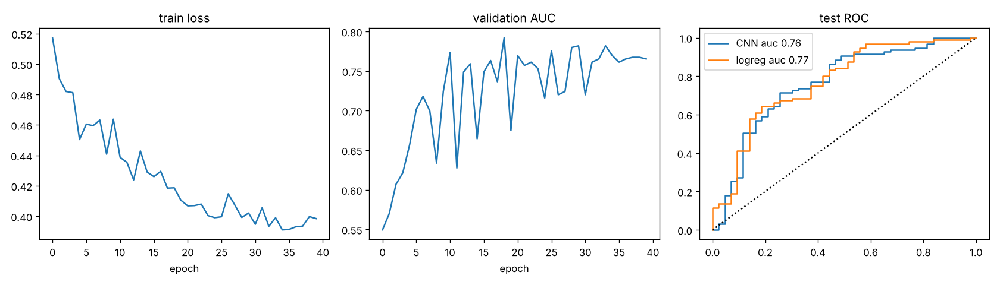
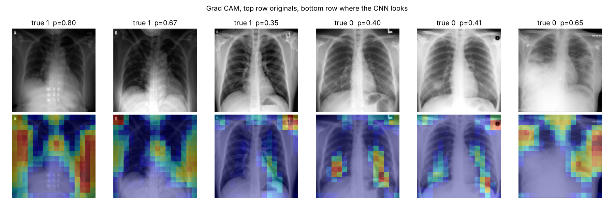

# COVID detection from chest radiographs with a small CNN

A PyTorch project that trains a convolutional network to tell COVID pneumonia apart from other findings on frontal chest films, then uses Grad CAM to check what the network is actually looking at.

The interesting part of this project is not the accuracy. It is that the heatmaps show the model picking up on things like the "L" marker in the corner of the film, which is a textbook example of shortcut learning in medical imaging.

## Data

Images come from the public [covid chestxray dataset](https://github.com/ieee8023/covid-chestxray-dataset) by Cohen et al. `data.py` downloads the metadata, keeps only frontal (PA and AP) radiographs, drops CT scans and lateral views, resizes everything to 128x128 grayscale and caches it as a compressed numpy file. The final set is 535 images from 352 patients, 342 labelled COVID and 193 labelled something else (bacterial pneumonia, other viral pneumonia, no finding, and so on).

Splits are done by patient id with `GroupShuffleSplit` so no patient appears in more than one of train, validation and test. This matters because many patients have several films taken days apart and a random split would leak.

## Model

A four block CNN (conv, batch norm, relu, max pool) with global average pooling and a single logistic output. Class imbalance is handled with `pos_weight` in the loss. Augmentation is small random translations plus brightness and contrast jitter. No horizontal flips, since left and right are meaningful in a chest film. Training uses Adam with a cosine learning rate schedule for 40 epochs and keeps the checkpoint with the best validation AUC.

A logistic regression on raw pixels is trained as a baseline.

## Results

| model | test AUC | test F1 |
| --- | --- | --- |
| logistic regression on pixels | 0.770 | |
| small CNN | 0.763 | 0.806 |

Confusion matrix on the 138 test images (rows are truth, columns are prediction):

```
            pred other  pred covid
true other      24          19
true covid      18          77
```

So the CNN is no better than a linear model on this dataset. With only 352 training images collected from dozens of hospitals and papers, there is not enough signal for the convolutional layers to learn anything that generalises beyond what pixel intensity statistics already give you.



## What Grad CAM shows



Several of the heatmaps light up on the corners of the film where hospitals stamp laterality markers and text, not on the lungs. Since COVID and non COVID images in this dataset largely come from different sources, the network can partially separate the classes by learning which hospital the film came from. This is the same failure mode documented in the literature on early COVID detection models (for example DeGrave et al., Nature Machine Intelligence 2021), and it is why a model like this should not be trusted clinically even if its AUC looked good.

Things that would help: lung segmentation or cropping to remove the borders, a much larger single source dataset, and pretrained backbones.

## Running it

```
pip install -r requirements.txt
python data.py      # downloads and caches the images, takes a minute
python train.py     # trains on CPU in about two minutes
```

Outputs land in `results/`: `metrics.json`, `training.png`, `gradcam.png` and the model weights `cnn.pt`.
